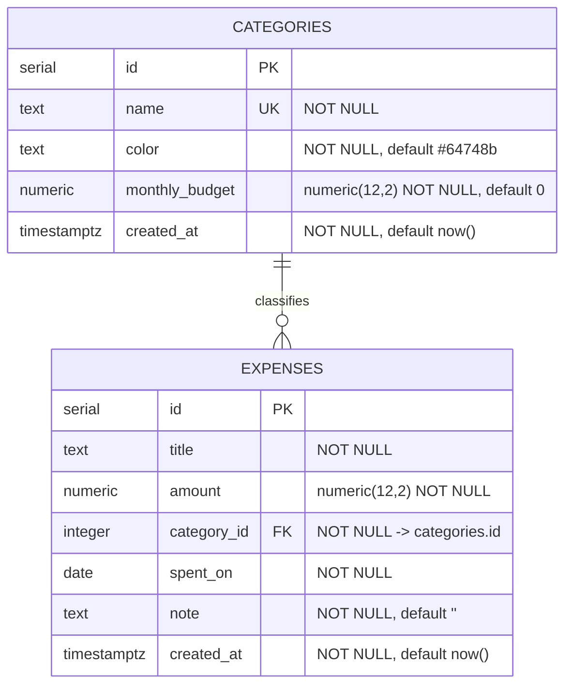

# Database Schema & Setup Guide

Ledgerly stores its data in **Netlify Database**, a managed **PostgreSQL** database. The schema is written in TypeScript with **Drizzle ORM** (`db/schema.ts`). Drizzle Kit turns that schema into SQL migration files in `netlify/database/migrations/`.

## 1. Entity–Relationship diagram



**Relationship:** one category has many expenses (1 : N). Each expense belongs to exactly one category.

## 2. Tables

### `categories`

| Column | Type | Constraints | Description |
| ------ | ---- | ----------- | ----------- |
| `id` | `serial` | **PRIMARY KEY** | Auto-incrementing id |
| `name` | `text` | `NOT NULL`, **UNIQUE** | Display name, e.g. "Transport" |
| `color` | `text` | `NOT NULL`, default `'#64748b'` | Hex colour used in the UI |
| `monthly_budget` | `numeric(12,2)` | `NOT NULL`, default `0` | Spending limit per month (0 = none) |
| `created_at` | `timestamptz` | `NOT NULL`, default `now()` | When the row was created |

### `expenses`

| Column | Type | Constraints | Description |
| ------ | ---- | ----------- | ----------- |
| `id` | `serial` | **PRIMARY KEY** | Auto-incrementing id |
| `title` | `text` | `NOT NULL` | Short description |
| `amount` | `numeric(12,2)` | `NOT NULL` | Amount spent (exact decimal, no floating-point rounding) |
| `category_id` | `integer` | `NOT NULL`, **FOREIGN KEY** → `categories(id)` `ON DELETE RESTRICT` | Category of the expense |
| `spent_on` | `date` | `NOT NULL` | Date the money was spent |
| `note` | `text` | `NOT NULL`, default `''` | Optional free-text note |
| `created_at` | `timestamptz` | `NOT NULL`, default `now()` | When the row was created |

### Indexes

| Index | Column | Why |
| ----- | ------ | --- |
| `expenses_spent_on_idx` | `expenses(spent_on)` | Fast month range queries (`spent_on >= '2026-11-01' AND spent_on < '2026-12-01'`) |
| `expenses_category_id_idx` | `expenses(category_id)` | Fast category filters and joins |

### Design decisions

- **`numeric(12,2)` for money** instead of `float`, because floating-point numbers cannot store values like `0.10` exactly. The API returns amounts as strings to keep that precision.
- **`ON DELETE RESTRICT`**: a category that still has expenses cannot be deleted, so no expense is ever left without a category (referential integrity).
- **`date` for `spent_on`**: an expense belongs to a calendar day, not to a moment in time, so time zones don't move it to another day.
- **Normalisation (3NF):** category details live only in `categories`. Expenses refer to them by `category_id`, and a JOIN brings the name and colour back.

## 3. Schema source (Drizzle ORM)

`db/schema.ts`

```ts
export const categories = pgTable("categories", {
  id: serial().primaryKey(),
  name: text().notNull().unique(),
  color: text().notNull().default("#64748b"),
  monthlyBudget: numeric("monthly_budget", { precision: 12, scale: 2 }).notNull().default("0"),
  createdAt: timestamp("created_at", { withTimezone: true }).notNull().defaultNow(),
});

export const expenses = pgTable("expenses", {
  id: serial().primaryKey(),
  title: text().notNull(),
  amount: numeric({ precision: 12, scale: 2 }).notNull(),
  categoryId: integer("category_id").notNull().references(() => categories.id, { onDelete: "restrict" }),
  spentOn: date("spent_on").notNull(),
  note: text().notNull().default(""),
  createdAt: timestamp("created_at", { withTimezone: true }).notNull().defaultNow(),
}, (t) => [
  index("expenses_spent_on_idx").on(t.spentOn),
  index("expenses_category_id_idx").on(t.categoryId),
]);
```

## 4. Migrations

Migrations live in `netlify/database/migrations/` and run in order of their timestamp prefix:

| Migration | What it does |
| --------- | ------------ |
| `20261109151652_create_categories_and_expenses` | Creates both tables, the indexes and the foreign key (generated by Drizzle Kit) |
| `20261109151653_seed_default_categories` | Adds 8 starter categories with budgets (hand-written SQL) |

Generated DDL (first migration):

```sql
CREATE TABLE "categories" (
  "id" serial PRIMARY KEY,
  "name" text NOT NULL UNIQUE,
  "color" text DEFAULT '#64748b' NOT NULL,
  "monthly_budget" numeric(12,2) DEFAULT '0' NOT NULL,
  "created_at" timestamp with time zone DEFAULT now() NOT NULL
);

CREATE TABLE "expenses" (
  "id" serial PRIMARY KEY,
  "title" text NOT NULL,
  "amount" numeric(12,2) NOT NULL,
  "category_id" integer NOT NULL,
  "spent_on" date NOT NULL,
  "note" text DEFAULT '' NOT NULL,
  "created_at" timestamp with time zone DEFAULT now() NOT NULL
);

CREATE INDEX "expenses_spent_on_idx" ON "expenses" ("spent_on");
CREATE INDEX "expenses_category_id_idx" ON "expenses" ("category_id");
ALTER TABLE "expenses" ADD CONSTRAINT "expenses_category_id_categories_id_fkey"
  FOREIGN KEY ("category_id") REFERENCES "categories"("id") ON DELETE RESTRICT;
```

Seed data (second migration):

| name | color | monthly_budget |
| ---- | ----- | -------------- |
| Food & Dining | `#e76f51` | 6000 |
| Transport | `#2a9d8f` | 2000 |
| Shopping | `#e9c46a` | 3000 |
| Bills & Utilities | `#264653` | 4000 |
| Entertainment | `#9b5de5` | 1500 |
| Health | `#f15bb5` | 1000 |
| Education | `#00bbf9` | 2500 |
| Other | `#64748b` | 1000 |

### Changing the schema

1. Edit `db/schema.ts` (for example, add a column).
2. Generate a migration: `npx drizzle-kit generate --name add_payment_method`
3. Commit the new folder in `netlify/database/migrations/`.
4. Deploy. Netlify applies pending migrations before the deploy goes live. If a migration fails, the deploy is not published.

Never edit a migration that has already been applied. Add a new one instead.

## 5. Setup guide

### Prerequisites

- Node.js 20 or newer (`node -v`)
- Netlify CLI: `npm install -g netlify-cli`
- A Netlify account, with the project linked through `netlify link` (or created with `netlify init`)

### Run locally

```bash
git clone <your-repo-url> expense-tracker
cd expense-tracker
npm install                       # installs React, Vite, Drizzle, @netlify/database …
netlify link                      # connect the folder to your Netlify project (first time only)
netlify db migrations apply       # create the tables in your local development database
netlify dev                       # start frontend + API + database at http://localhost:8889
```

`netlify dev` gives you a local development database. You don't need a connection string because `@netlify/database` connects automatically. To start over with an empty local database, run `netlify db reset` and then apply the migrations again.

### Deploy

Push to the Git branch that is connected to Netlify, or run `netlify deploy --prod`. On every deploy Netlify:

1. Runs `npm run build` (Vite builds `dist/`)
2. Bundles the functions in `netlify/functions/`
3. Applies any pending migrations to the production database
4. Publishes the site

Deploy previews get their own **database branch**: an isolated copy of production data. Testing a change there never touches production data.

### Inspecting data

```bash
netlify db status                                               # applied / pending migrations
netlify db connect --query "SELECT * FROM categories"           # read-only query
netlify db connect --query "SELECT * FROM expenses ORDER BY spent_on DESC LIMIT 10" --json
```

## 6. Useful SQL queries (equivalents of what the API runs)

```sql
-- Expenses for November 2026 with their category (GET /api/expenses?month=2026-11)
SELECT e.id, e.title, e.amount, c.name AS category, e.spent_on
FROM expenses e
JOIN categories c ON c.id = e.category_id
WHERE e.spent_on >= '2026-11-01' AND e.spent_on < '2026-12-01'
ORDER BY e.spent_on DESC, e.id DESC;

-- Spending against budget for each category (GET /api/summary)
SELECT c.name, c.monthly_budget,
       COALESCE(SUM(e.amount), 0) AS spent,
       COUNT(e.id)                AS entries
FROM categories c
LEFT JOIN expenses e
  ON e.category_id = c.id
 AND e.spent_on >= '2026-11-01' AND e.spent_on < '2026-12-01'
GROUP BY c.id
ORDER BY spent DESC;

-- Daily totals
SELECT spent_on, SUM(amount) AS total
FROM expenses
WHERE spent_on >= '2026-11-01' AND spent_on < '2026-12-01'
GROUP BY spent_on
ORDER BY spent_on;
```
