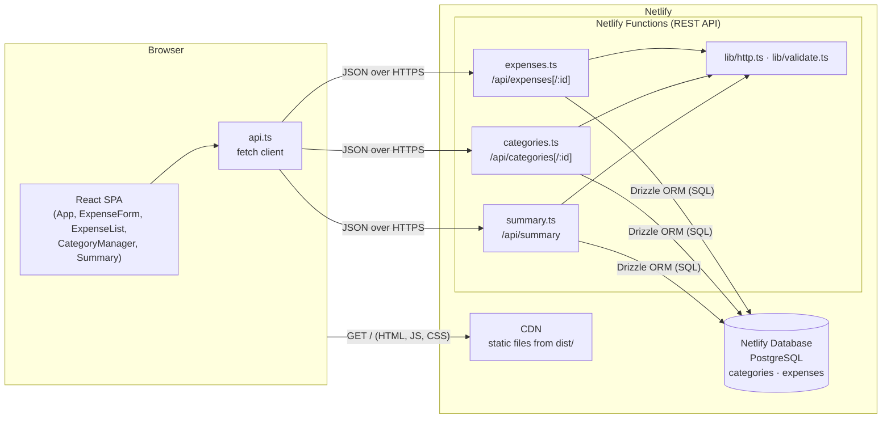
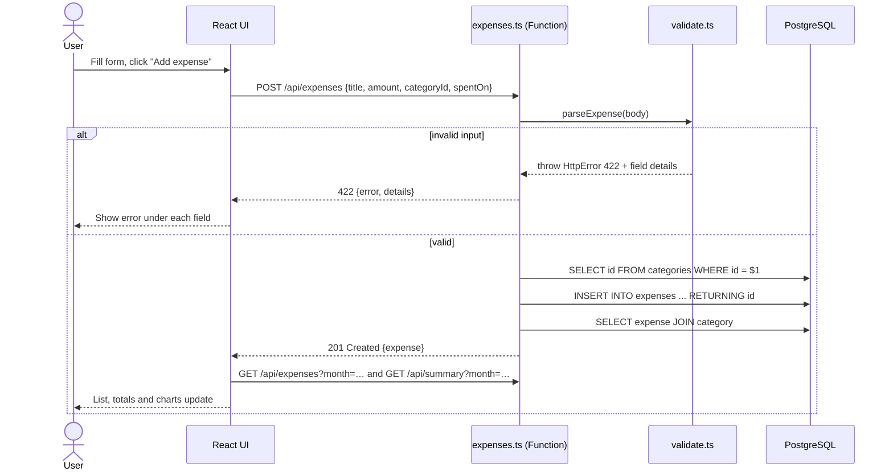
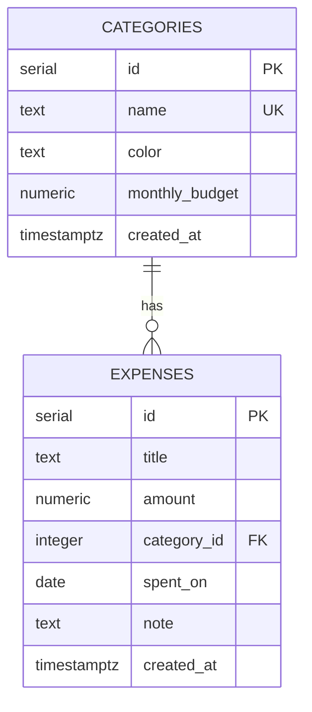
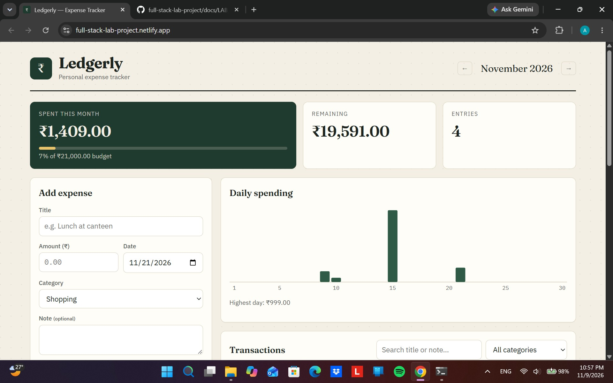
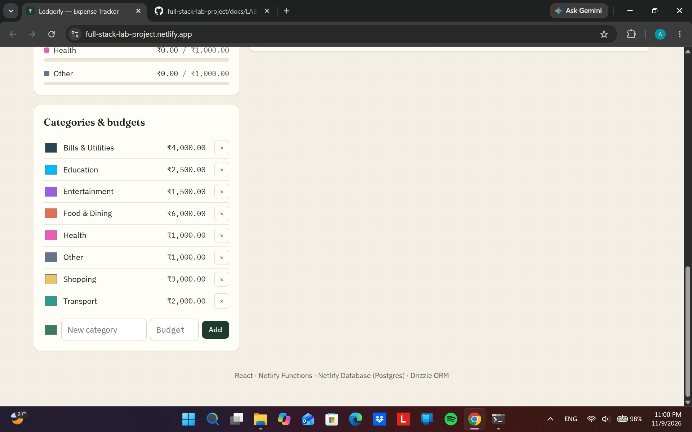
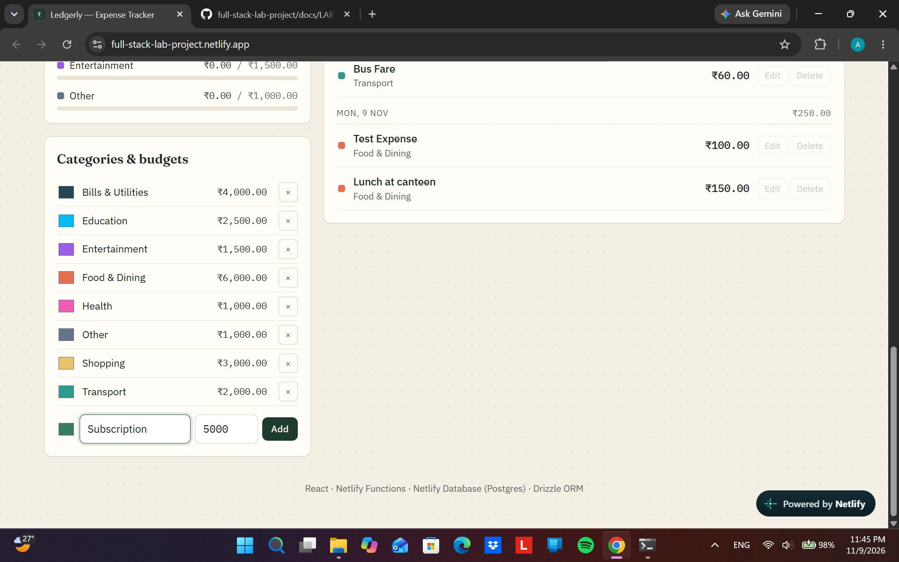
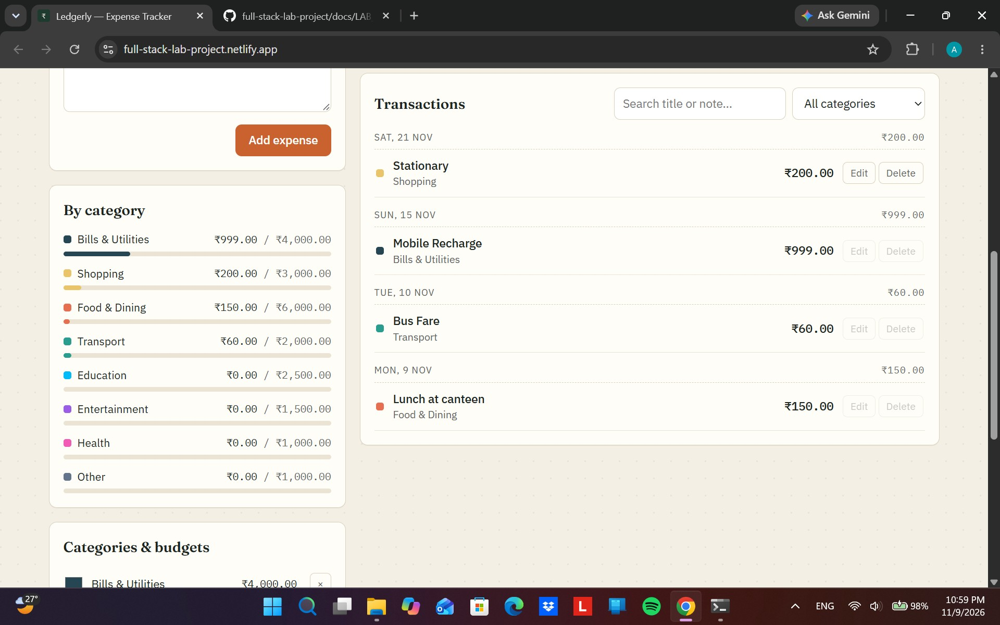
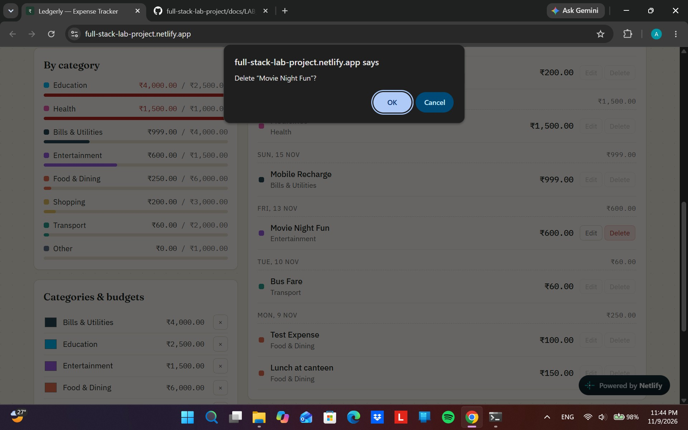
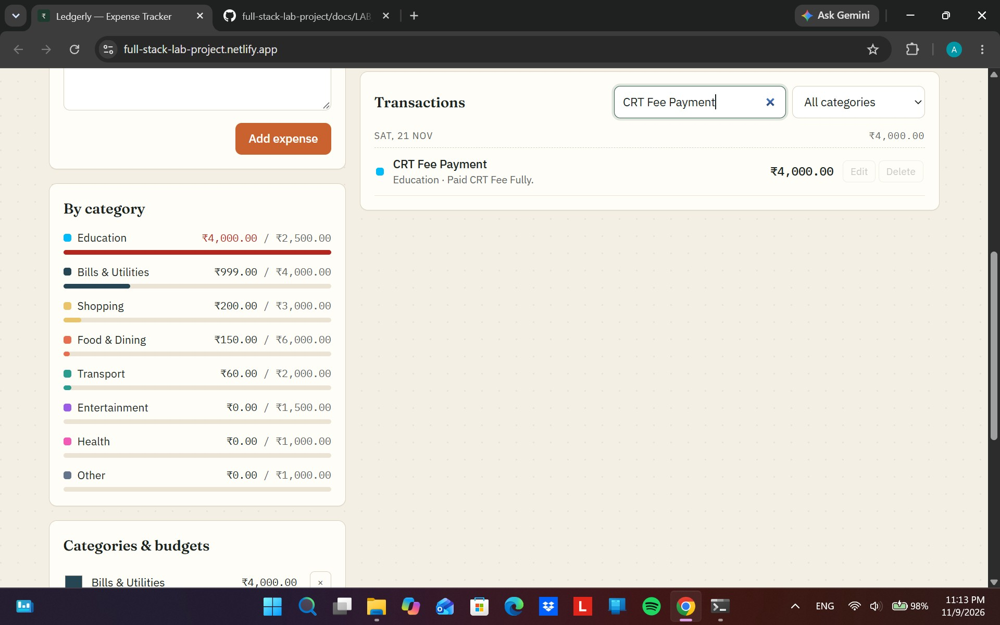
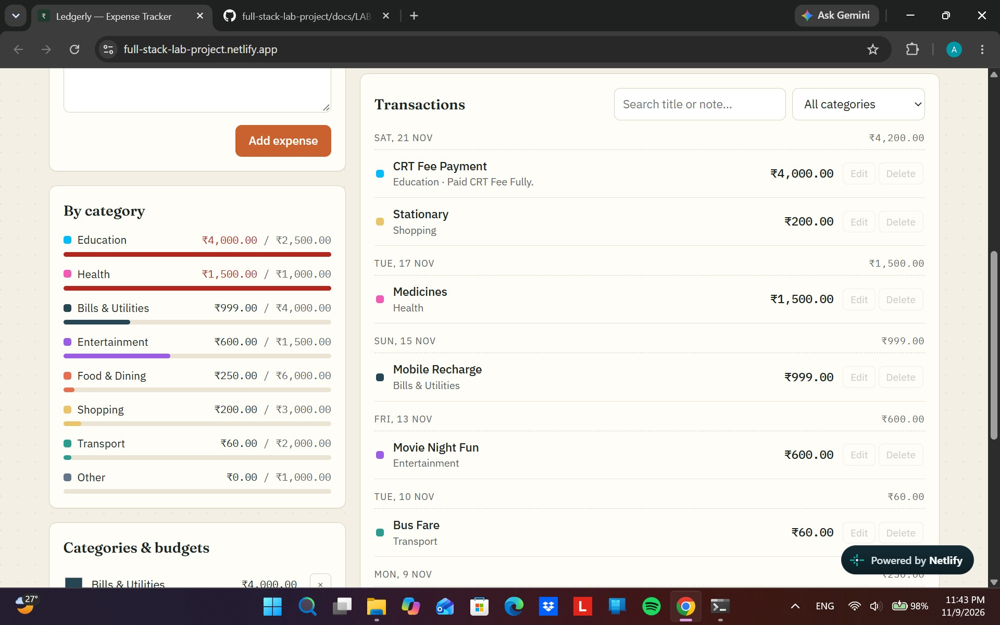

# Lab Report: Full-Stack Expense Tracker ("Ledgerly")

| | |
| --- | --- |
| **Student name** | 1.Ashish Chidi <br> 2. Nirmal Chhetri <br> 3. Himal Chidi|
| **Register no.** |1. 24221A4558 <br> 2. 24221A4561 <br> 3. 24221A4560|
| **Lab** | Full Stack Development Lab |
| **Lab In-Charge.** | Mrs .K. Varalakshmi|
| **Date** | 10/09/2026|
| **Live URL** | https://full-stack-lab-project.netlify.app |
| **Source code** |https://github.com/Ashishx10/full-stack-lab-project|

---

## 1. Aim

To design, build and deploy a full-stack **expense tracker** web application with a React frontend, a REST API backend on serverless functions, and a relational PostgreSQL database. The app must support full CRUD (Create, Read, Update, Delete) on expenses and categories, plus monthly reports.

## 2. Objectives

1. Build a responsive single-page frontend with React and TypeScript.
2. Build a RESTful API with proper HTTP methods, status codes and JSON error responses.
3. Design a normalised relational schema with primary keys, foreign keys, constraints and indexes.
4. Use an ORM (Drizzle) and version-controlled migrations to manage the database schema.
5. Validate input on both the client and the server.
6. Deploy the complete application to the cloud (Netlify).

## 3. Problem statement

People often lose track of small daily spending. The application should let a user:

- record each expense with a title, amount, category, date and an optional note,
- organise spending into categories, each with a monthly budget,
- see how much was spent this month, how much budget is left, and which categories are over budget,
- browse earlier months, search and filter transactions, and fix or delete mistakes.

## 4. Tools & technology stack

| Layer | Technology | Purpose |
| ----- | ---------- | ------- |
| Language | **TypeScript** | Type-safe JavaScript for both frontend and backend |
| Frontend | **React 19** | Component-based UI library |
| Build tool | **Vite** | Dev server with hot reload; production bundling |
| Backend | **Netlify Functions** | Serverless functions that serve the REST API (Node.js runtime, Web `Request`/`Response` API) |
| Database | **Netlify Database (PostgreSQL)** | Managed relational database |
| ORM | **Drizzle ORM + Drizzle Kit** | Type-safe queries; schema → SQL migration generation |
| Hosting | **Netlify** | Global CDN for static files, serverless API, automatic migrations |
| Tools | Node.js, npm, Netlify CLI, Git, VS Code, curl / Postman | Development and testing |

## 5. Theory

**Full-stack application.** A full-stack application has three parts: the *client* (the UI running in the browser), the *server* (business logic and an API), and the *database* (persistent storage). This project builds and connects all three.

**REST (Representational State Transfer).** In REST, every resource has its own URL (`/api/expenses/12`). HTTP verbs say what to do with it: `GET` reads, `POST` creates, `PUT`/`PATCH` updates and `DELETE` removes. Every request carries everything the server needs, so the server keeps no session state. Status codes report the outcome (`201 Created`, `404 Not Found`, `422 Unprocessable Entity`, and so on).

**Serverless functions.** The cloud provider runs the code on demand for each request instead of keeping a server running all the time. The developer only writes handlers. Scaling, uptime and patching are the provider's job.

**Relational database & normalisation.** Data is stored in tables linked by keys. Category details are stored once in `categories`, and each expense points to its category through the foreign key `category_id`. This avoids duplicate data and update anomalies (Third Normal Form).

**ORM & migrations.** An Object-Relational Mapper lets you write queries in the application language with type checking. A migration is a versioned SQL file that changes the schema. Applying the migrations in order recreates the same schema in every environment.

## 6. System architecture



### Request flow (example: adding an expense)



### Module description

| Module | File(s) | Responsibility |
| ------ | ------- | -------------- |
| UI shell | `src/App.tsx` | Holds app state (month, filters, data), loads data, coordinates components |
| Expense form | `src/components/ExpenseForm.tsx` | Create/edit form showing server validation errors per field |
| Transaction list | `src/components/ExpenseList.tsx` | Ledger grouped by day, with search, category filter, edit and delete |
| Categories | `src/components/CategoryManager.tsx` | Add categories; change colour or budget; delete |
| Dashboard | `src/components/Summary.tsx` | Stat tiles, per-category budget bars, daily SVG bar chart |
| API client | `src/api.ts` | Typed wrapper around `fetch` for every endpoint |
| Expenses API | `netlify/functions/expenses.ts` | CRUD and filtering for expenses |
| Categories API | `netlify/functions/categories.ts` | CRUD for categories; blocks deleting a category that has expenses |
| Summary API | `netlify/functions/summary.ts` | SQL aggregation (`SUM`, `COUNT`, `GROUP BY`, `LEFT JOIN`) |
| Shared helpers | `netlify/lib/*.ts` | Error handling, JSON responses, input validation |
| Data layer | `db/schema.ts`, `db/index.ts` | Table definitions and database client |

## 7. Database design

Two tables in a one-to-many relationship. The full schema, ER diagram and migrations are in [DATABASE.md](DATABASE.md).



## 8. API design

Full request and response examples are in [API.md](API.md).

| Method | Endpoint | Description | Success |
| ------ | -------- | ----------- | ------- |
| GET | `/api/expenses?month=&categoryId=&q=` | List/filter/search expenses | 200 |
| POST | `/api/expenses` | Create expense | 201 |
| GET | `/api/expenses/:id` | Read one expense | 200 |
| PUT/PATCH | `/api/expenses/:id` | Update expense | 200 |
| DELETE | `/api/expenses/:id` | Delete expense | 204 |
| GET | `/api/categories` | List categories | 200 |
| POST | `/api/categories` | Create category | 201 |
| PUT/PATCH | `/api/categories/:id` | Update name/colour/budget | 200 |
| DELETE | `/api/categories/:id` | Delete category (if unused) | 204 |
| GET | `/api/summary?month=YYYY-MM` | Monthly totals by category & day | 200 |

## 9. Procedure (steps performed)

1. **Set up the project.** Created a Node.js project and installed the dependencies:
   ```bash
   npm install react react-dom @netlify/functions @netlify/database drizzle-orm@beta
   npm install -D vite @vitejs/plugin-react typescript drizzle-kit@beta @types/react @types/react-dom @types/node
   ```
2. **Configured the tooling.** Added `vite.config.ts`, `tsconfig.json`, `drizzle.config.ts` (migrations output to `netlify/database/migrations`) and `netlify.toml` (build command `npm run build`, publish dir `dist`, functions dir `netlify/functions`).
3. **Designed the database.** Defined the `categories` and `expenses` tables in `db/schema.ts` with a primary key, a unique constraint, a foreign key with `ON DELETE RESTRICT`, default values and two indexes.
4. **Generated migrations.**
   ```bash
   npx drizzle-kit generate --name create_categories_and_expenses
   npx drizzle-kit generate --custom --name seed_default_categories   # then wrote INSERT statements
   ```
5. **Wrote the backend.** Added three Netlify Functions, each mapped to a URL path with `export const config = { path: [...] }`. Shared helpers convert thrown `HttpError`s into JSON responses with the right status code. Validators check every field and collect the errors.
6. **Wrote the frontend.** Created a typed API client (`src/api.ts`) and React components for the form, ledger, category manager and dashboard. Search input is debounced (250 ms). Each submit or delete reloads the list and summary.
7. **Styled the UI.** Wrote responsive CSS with a two-column layout that collapses to one column below 860 px, using the Fraunces, IBM Plex Sans and IBM Plex Mono fonts.
8. **Tested locally.** Ran `netlify db migrations apply` and `netlify dev`, used the UI, and tested each endpoint with `curl` (see Section 10).
9. **Deployed.** Pushed to Git. Netlify built the frontend, bundled the functions, applied the migrations to the production database and published the site.

## 10. Testing

Run with `netlify dev` at `http://localhost:8889`. Tick each box after you check the result yourself.

| # | Test case | Input / action | Expected result | Pass |
| - | --------- | -------------- | --------------- | ---- |
| 1 | Load app | Open `/` | Dashboard loads; 8 default categories are listed | ☐ |
| 2 | Create expense | `POST /api/expenses` with valid body | `201`, expense returned with `categoryName` | ☐ |
| 3 | Missing fields | `POST /api/expenses` with `{"title":"","amount":-5,"spentOn":"bad"}` | `422` with `details` for title, amount, categoryId, spentOn | ☐ |
| 4 | Invalid JSON | `POST /api/expenses` with body `notjson` | `400 Request body must be a JSON object` | ☐ |
| 5 | Unknown category | `POST /api/expenses` with `categoryId: 9999` | `422`, `categoryId: "Category does not exist"` | ☐ |
| 6 | List by month | `GET /api/expenses?month=2026-11` | Only November 2026 expenses, newest first | ☐ |
| 7 | Search | `GET /api/expenses?q=lunch` | Case-insensitive matches in title or note | ☐ |
| 8 | Update | `PUT /api/expenses/:id` with `{"amount":200}` | `200`; only `amount` changes | ☐ |
| 9 | Delete | `DELETE /api/expenses/:id` | `204`; then `GET` on it returns `404` | ☐ |
| 10 | Bad id | `GET /api/expenses/abc` | `400 Invalid id` | ☐ |
| 11 | Wrong method | `POST /api/summary` | `405 Method not allowed` | ☐ |
| 12 | Duplicate category | `POST /api/categories` with an existing name | `409` conflict | ☐ |
| 13 | Bad colour | `POST /api/categories` with `"color":"red"` | `422`, colour error | ☐ |
| 14 | Delete used category | `DELETE /api/categories/:id` on a category with expenses | `409` with expense count | ☐ |
| 15 | Summary | `GET /api/summary?month=2026-11` | Totals equal the sum of the listed expenses; unused categories show `0.00` | ☐ |
| 16 | Bad month | `GET /api/summary?month=2026-13` | `400 month must be in YYYY-MM format` | ☐ |
| 17 | Over budget (UI) | Add expenses beyond a category's budget | Bar turns red; "Over budget" tile appears when total > budget | ☐ |
| 18 | Responsive (UI) | Resize window to < 860 px | Layout becomes a single column | ☐ |

Example commands:

```bash
curl -i -X POST localhost:8889/api/expenses -H "Content-Type: application/json" \
     -d '{"title":"Lunch","amount":120,"categoryId":1,"spentOn":"2026-11-09"}'
curl -i "localhost:8889/api/summary?month=2026-11"
```

## 11. Output / screenshots

## Screenshots
## 10. Application Screenshots

### Dashboard


### Categories and Budgets


### Adding a Category


### Transactions


### Delete Confirmation


### Updated Transactions


### Budget Status


## 12. Result

The full-stack expense tracker was built and deployed. The React frontend talks to a serverless REST API through JSON over HTTPS. The API stores and queries data in a managed PostgreSQL database through Drizzle ORM. All CRUD operations, filtering, search, monthly aggregation and budget tracking work. Invalid input gets proper HTTP status codes and messages for each field.

## 13. Conclusion

This experiment showed how the three tiers of a modern web application fit together:

- **Frontend:** component-based UI, managed state, and data loaded from the API with `fetch`.
- **Backend:** REST conventions, server-side validation, consistent error handling, and serverless deployment with no servers to manage.
- **Database:** relational modelling with keys and constraints, aggregate SQL (`SUM`, `COUNT`, `GROUP BY`, `LEFT JOIN`), and schema changes tracked through migrations.

**Possible extensions:** user accounts (authentication) so each user sees only their own data, CSV export, recurring expenses, multiple currencies, and charts that compare spending across months.

## 14. Viva questions (with short answers)

1. **What is the difference between PUT and PATCH?** PUT replaces the whole resource and PATCH changes only some fields. This API accepts partial bodies for both.
2. **Why store money as `numeric(12,2)` and not `float`?** Floating-point numbers cannot store most decimal fractions exactly (0.1 + 0.2 ≠ 0.3). `numeric` is an exact decimal type.
3. **What does `ON DELETE RESTRICT` do?** The database refuses to delete a category while expenses still reference it, so data stays consistent.
4. **Why validate on the server if the form already validates?** Anyone can call the API directly, without the UI. The server is the only place where checks can be enforced.
5. **What is a migration?** A versioned SQL script that changes the schema. Applying migrations in order gives the same schema in every environment.
6. **Why use a LEFT JOIN in the summary?** So that categories with no expenses that month still appear, with a total of 0.
7. **What is a serverless function?** Code the platform runs on demand for each request. It scales automatically, and you never manage a server.
8. **What is an index and why add one on `spent_on`?** A data structure (B-tree) that lets the database find rows by that column without reading the whole table. Month filters use it.
9. **How is SQL injection prevented?** Drizzle sends all values as query parameters and never joins them into the SQL string. The search pattern also escapes `%` and `_`.
10. **What does status 422 mean?** The request was well-formed JSON, but its content failed validation.
